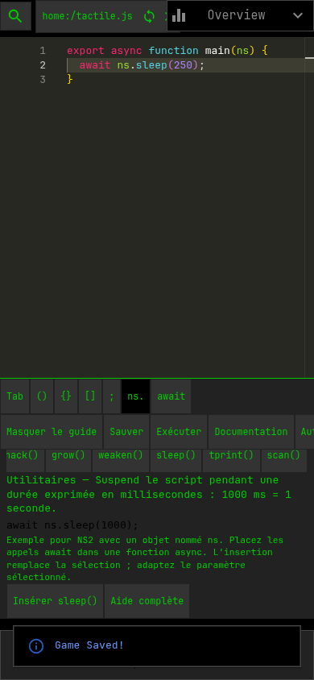
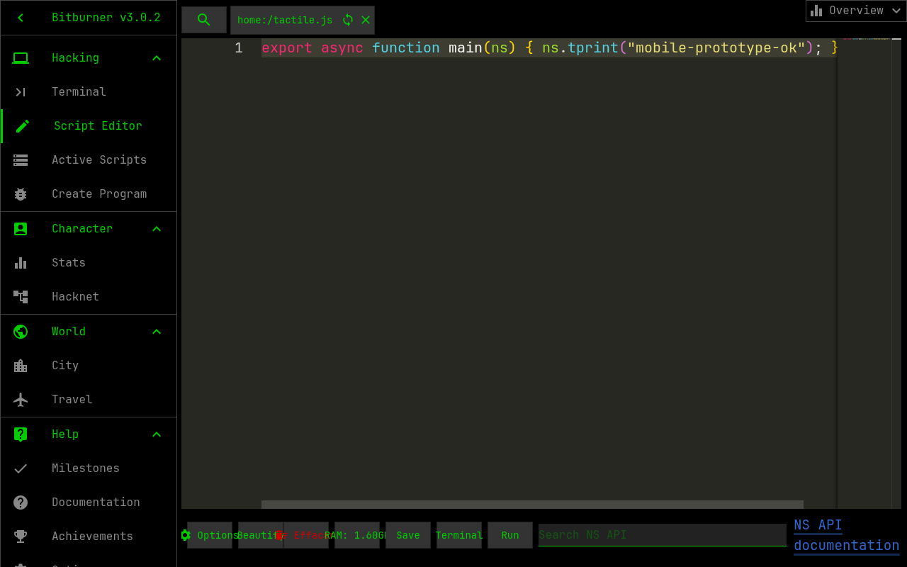

# Prototype de l’éditeur mobile — étapes 1 et 2

## Base vérifiée

`mobile-ui` et `refactor/mobile-script-editor` pointaient toutes deux sur
`7f7daf7a7c588dc02ccbe4d9a7e1772d2124ba70` avant ce prototype. L’adaptation
existante est conservée : viewport mobile, navigation inférieure, menu des pages,
terminal compact, taille de police Monaco, retour à la ligne et barre d’outils
responsive. La branche de travail seule reçoit les modifications.

## Architecture et risques identifiés

- `ScriptEditorRoot.tsx` orchestre les onglets, modèles, sauvegarde, exécution,
  formatage, diagnostics et analyse RAM. Les nouveaux boutons réutilisent ses
  fonctions de sauvegarde et d’exécution.
- `Editor.tsx` initialise Monaco et ses bibliothèques de types. Sa sauvegarde
  automatique sur perte de focus reste active selon les préférences existantes.
- `OpenScript.ts`, `EditorData.ts`, `Tabs.tsx` et `utils.ts` conservent la gestion
  des fichiers et les chemins de sauvegarde actuels.
- `Toolbar.tsx` reste accessible en entier dans « Autres outils » sur mobile,
  et reste affichée sur ordinateur.
- `DocumentationPopUp.tsx` et les pages intégrées sont réutilisées : aucune
  ouverture de site externe n’est nécessaire pour consulter l’aide Netscript.

Le clavier Android peut réduire le viewport visible sans réduire le viewport de
mise en page. Un hook suit `visualViewport.resize` et `visualViewport.scroll`,
avec repli sur `window.innerHeight`. La disposition reste limitée à l’éditeur,
réserve de la place à la navigation mobile et ne recrée pas les modèles Monaco.
Le défilement du guide et des outils supplémentaires est limité à leurs panneaux.

Le volet personnage « Overview » pouvait masquer une grande partie du code.
Son bouton de réduction utilise désormais le clic natif du bouton, exclu de la
zone de glissement : un appui tactile le réduit sans double bascule. Le volet
reste disponible et son en-tête reste déplaçable.

Les touches d’insertion empêchent la perte de focus sur `pointerdown`, sans
intercepter l’activation au clavier. Elles sont désactivées pendant la composition
IME. Les insertions utilisent `executeEdits` et des bornes d’annulation ; elles
suivent donc les notifications normales de Monaco et la même analyse du script.
La documentation et les autres commandes peuvent toujours prendre le focus,
comme dans l’interface précédente.

## Tester sur téléphone

Prérequis : Node.js 24 ou plus récent, ordinateur et téléphone sur le même réseau.

```sh
git clone --branch refactor/mobile-script-editor https://github.com/Ankool29/bitburner-src.git
cd bitburner-src
npm ci
npm run start:dev -- --host 0.0.0.0
```

Sur Android, ouvrir `http://ADRESSE_IP_LOCALE_DE_L_ORDINATEUR:8000` dans Chrome.
Autoriser le port 8000 sur le réseau local si le pare-feu le demande. Cette adresse
de test a son propre stockage navigateur ; elle ne remplace pas la version jouable
sur GitHub Pages. Pour essayer une sauvegarde existante, en importer une copie.

1. Passer le tutoriel, puis créer un script avec `nano tactile.js` dans le terminal.
2. En portrait, réduire « Overview » avec sa flèche pour dégager le code et
   vérifier la présence de Monaco et des deux rangées d’outils.
3. Dans `export async function main(ns) { ... }`, placer le curseur dans le corps.
4. Essayer `Tab`, `()`, `{}`, `[]`, `;`, `ns.` et `await`. Pour les paires, le
   curseur doit se placer au milieu. Vérifier annuler/rétablir avec le menu Monaco
   ou un clavier physique.
5. Ouvrir « Instructions », sélectionner `sleep()`, lire l’aide, puis toucher
   « Insérer sleep() ». Le paramètre `1000` doit être sélectionné et remplaçable.
6. Essayer `hack`, `grow`, `weaken`, `tprint` et `scan`. Lire « Aide complète »,
   fermer la documentation et reprendre la saisie libre.
7. Sauvegarder, changer d’onglet, revenir, puis exécuter un script simple tel que
   `ns.tprint("test tactile");`. Vérifier les journaux et le calcul RAM habituel.
8. Ouvrir « Autres outils » et vérifier options, formatage, effacement, terminal,
   RAM et recherche documentaire. Fermer le panneau pour retrouver l’espace.
9. Répéter avec le clavier virtuel ouvert, puis fermé, après rotation et avec
   une longue ligne/un long fichier. Vérifier focus, sélection et défilement.
10. Essayer Gboard et le clavier Samsung, les accents, suggestions et compositions
    IME ; répéter avec l’autosauvegarde au changement de focus activée.
11. Ouvrir un fichier JSON/CSS ou `.script` : l’insertion Netscript moderne et le
    bouton d’exécution mobile doivent être désactivés ; la saisie libre demeure.
12. Sur ordinateur (> 600 px), vérifier l’interface habituelle, Vim,
    autocomplétion, recherche/remplacement et préférences de police/minimap.

## Limites volontaires

- Six exemples courants, pas de catalogue exhaustif ni d’analyse intelligente du
  contexte. Ils supposent un objet `ns` et une fonction `async` pour `await`.
- L’insertion remplace la sélection ; les paires ne l’enveloppent pas.
- Les paramètres se modifient directement dans le code, sans formulaire dédié.
- Les rangées de boutons défilent horizontalement si elles dépassent la largeur.
- Le comportement réel des claviers Android nécessite un essai sur appareil ; une
  simulation de viewport ne reproduit pas les comportements de chaque IME.
- Aucun déploiement Pages n’est déclenché pour cette branche : le workflow mobile
  actuel cible `mobile-ui`. Ne pas le lancer manuellement sur ce prototype, car il
  publierait sur le même site que la version jouable.

## Vérifications reproductibles

```sh
npm run typecheck
npm run lint:report
npm test -- --runInBand
npm run build
```

Les tests du prototype sont dans `test/jest/ui/MobileScriptTools.test.tsx`.
Le formatage de la base mobile comporte déjà des écarts dans `Toolbar.tsx` et
`MobileNavigation.tsx` ; ces fichiers restent inchangés dans cette proposition.

Validation réalisée avec Node.js 24 : typage et lint réussis ; 60 suites Jest
réussies, 4 586 tests réussis, 4 ignorés et 141 snapshots validés. La compilation
de production réussit avec les avertissements de taille des bundles Webpack.
Vingt contrôles Chromium ont également réussi en simulation tactile à 390 × 844,
à hauteur réduite 390 × 420, puis sur ordinateur à 1280 × 800 : insertion,
curseur, focus, annuler/rétablir, multi-curseurs, paramètre sélectionné, saisie
libre, sauvegarde, exécution, documentation interne et conservation du modèle
pendant le redimensionnement. Aucune erreur JavaScript du navigateur relevée.
Ces essais ne constituent pas une validation sur appareil Android physique.




