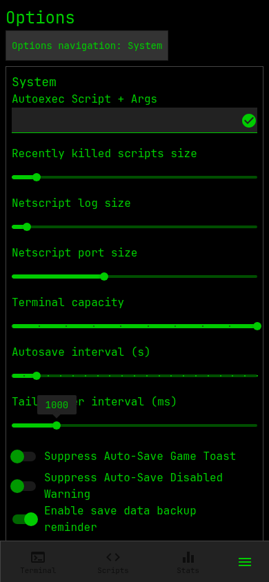
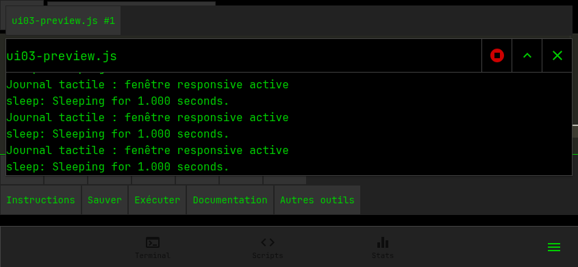

# UI-03 — Fenêtres responsive sur smartphone

## Révision et périmètre

Base : `mobile-ui`, commit `7d011b5afe17bd48ae7e826ba5707390f8433e68`.
Branche : `refactor/mobile-responsive-windows`. L’éditeur tactile de la PR #1
est conservé. Aucun fichier du moteur Netscript, des mécaniques, des modèles de
sauvegarde ou des dépendances npm n’est modifié. Aucun déploiement Pages.

Le recensement structurel porte sur 396 composants TSX, dont 71 utilisateurs
explicites du composant `Modal`, 43 composants avec des tableaux et 32 composants
`*Root.tsx`. Le routeur principal comporte 38 destinations explicites. Cela ne
signifie pas que les 396 composants ni toutes leurs combinaisons d’état ont été
exercés en navigateur. L’inventaire détaillé ci-dessous couvre aussi les fonctions
avancées qui ne sont pas visibles au démarrage.

## Comportements communs

- `ResponsiveLayout.tsx` centralise le breakpoint téléphone (portrait jusqu’à
  600 px, ou paysage tactile jusqu’à 900 × 500), le viewport visible, les grilles,
  les régions défilantes, la lisibilité, les contrôles et les menus. Les valeurs
  desktop restent les valeurs de base, hors media query.
- `visualViewport` est suivi pour les changements de taille et de décalage,
  avec repli sur `innerWidth/innerHeight`, sans recréer les modèles ou formulaires.
  Une saisie active est révélée par défilement du corps du dialogue uniquement.
- Les dialogues longs utilisent presque tout l’écran ; les confirmations gardent
  leur hauteur naturelle. Un bouton de fermeture nommé, de 44 px, reste hors du
  corps défilant. Les contraintes inline de largeur/hauteur desktop sont bornées
  sur téléphone. Le verrouillage du fond et le focus modal sont actifs sur mobile.
- Les boutons ont une hauteur minimale de 44 px, les options de menu 48 px et les
  formulaires une police d’au moins 16 px. Les préférences de police supérieure
  à 16 px restent prises en compte. La police et les couleurs du thème sont gardées.
- Les tableaux MUI et HTML larges défilent dans leur propre boîte, avec barre de
  défilement visible. Les tableaux utilisés comme plateaux Stanek sont exclus.
- Les logs sont présentés un à un sur téléphone avec un sélecteur permettant de
  retrouver chaque fenêtre. Réduire, agrandir et fermer utilisent un seul clic
  natif. Les positions/dimensions stockées restent inchangées et reviennent sur
  ordinateur ; aucun changement des fonctions Netscript de gestion des tails.
- Overview est accessible depuis le menu mobile et disparaît lorsqu’il est fermé,
  afin de ne pas recouvrir les onglets. Son déplacement et ses préférences desktop
  sont conservés. Le tutoriel reste accessible, avec défilement borné.

## Audit par activité

| Domaine                    | Interfaces examinées                                                                                                                                                                   | Première passe                                                                                                                  |
| -------------------------- | -------------------------------------------------------------------------------------------------------------------------------------------------------------------------------------- | ------------------------------------------------------------------------------------------------------------------------------- |
| Système et dialogues       | Modal, StaticModal, ConfirmationModal, AlertManager, PromptManager, CodingContractModal, ErrorModal, KillScriptsModal, V2Modal, diagnostic et comparaison d’import                     | Socle commun, fermeture accessible, contenu long, formulaires et tableaux bornés ; règles de résolution/confirmation inchangées |
| Documentation et éditeur   | DocumentationPopUp/Root, options et thème Monaco, onglets, RAM, barre d’outils, guide tactile                                                                                          | Modales communes, navigation documentaire responsive ; saisie, raccourcis et undo préservés, y compris en paysage               |
| Terminal et exécution      | TerminalRoot/Input, LogBoxManager, ActiveScriptsRoot/Page, ServerAccordionContent, ScriptProduction, scripts arrêtés, erreurs récentes                                                 | Hauteur visible et police lisible, logs adaptés, tableaux locaux                                                                |
| Serveurs et réseau         | Cartes ville/monde, achat de serveurs, NetworkDisplayWrapper, dnetStyles, ServerDetailsModal, recherche et authentification Darknet                                                    | Listes tactiles ville/voyage avec cartes toujours disponibles ; réseau défilant, zoom accessible, détails via Modal             |
| Factions et augmentations  | FactionsRoot, FactionRoot, AugmentationsPage, campagnes, invitations, achat/création de gang, AugmentationsRoot, listes installées/achetées, SourceFiles                               | Grilles empilées et dialogues communs ; aucun changement des prérequis ni des coûts                                             |
| Entreprises et corporation | CompanyLocation, JobRoot, QuitJobModal, CorporationRoot, Overview, Division, bureaux, entrepôts, produits, matériaux et tous les modaux corporation listés ci-dessous                  | Colonnes mobiles, tableaux défilants, formulaires communs                                                                       |
| Hacknet et finances        | HacknetRoot, HashUpgradeModal, StockMarketRoot/Tickers/Orders, InfoAndPurchases, PlaceOrderModal, CharacterStats                                                                       | Cartes de largeur adaptée, tableaux internes, formulaires et cibles tactiles                                                    |
| Activités avancées         | BladeburnerRoot, console, voyages/effectifs/actions ; GangRoot, membres, équipement, territoire, ascension/recrutement ; SleeveRoot/Elem/FAQ/Stats/voyage/augmentations ; GraftingRoot | Grilles communes et fenêtres bornées ; logique d’action intacte                                                                 |
| Plateaux et autres pages   | IPvGO, Stanek, succès, jalons, programmes, options, thèmes, travail, Bitverse, récupération, infiltration, Arcade et pages personnalisées                                              | Conteneurs et tableaux communs ; cadre IPvGO et succès corrigés ; les contrôles des mini-jeux chronométrés ne sont pas réécrits |
| Navigation et réglages     | MobileNavigation, GameOptionsRoot/Sidebar, pages System/Interface/Numeric/Gameplay/Misc/RemoteAPI/KeyBinding, DocumentationAutocomplete, menus Select                                  | Navigation paysage, fermeture de menu visible, options repliables, listes et tableaux bornés au viewport                        |

## Validation et limites

Les scripts de navigateur sont dans `test/browser/`. Ils ouvrent un profil jetable
et injectent des états de test dans le serveur de développement, sans utiliser une
sauvegarde du joueur. Le balayage crée une corporation et une division, un gang,
Bladeburner, deux sleeves, un nœud Hacknet et un compte WSE pour examiner les pages
avancées. Les captures sont des captures de ces données de test.

Les dimensions demandées sont 390 × 844, 844 × 390, 360 × 740 et 1280 × 800.
Le clavier est simulé par une réduction de `visualViewport.height` ; il ne s’agit
pas d’un test physique de Gboard/Samsung. Les changements d’orientation conservent
les brouillons et modèles. Le script vérifie aussi les superpositions, les tails,
la documentation longue et la saisie tactile dans Monaco.

Résultats : 74 contrôles de fenêtres réussis ; 116 visites de pages, dont 87
mobiles sans débordement horizontal non contenu ; aucune erreur JavaScript.
Jest : 61 suites, 4 591 tests réussis, 4 ignorés et 141 snapshots validés.
Typage et lint réussis. Vingt contrôles supplémentaires passent sur la compilation de production :
collage JavaScript, exécution avec un vrai tail, réduction/agrandissement,
sauvegarde accessible sous les logs sur les trois formats mobiles et arrêt du
script. Le sélecteur des tails est placé en haut pour laisser libres les actions
de l’éditeur. La compilation de production réussit avec les trois avertissements Webpack de
taille des bundles.
Le [résumé JSON](ui-03-validation.json) conserve les chiffres et les observations.
Le débordement de la barre de documentation desktop à largeur 100 % est une
observation de la disposition desktop existante, laissée inchangée.

Reste à vérifier sur appareil Android : IME réels, zoom d’accessibilité et gestes
propres aux constructeurs. Les combinaisons rares de sous-fenêtres avancées et les
contenus React/HTML créés par les scripts du joueur ne sont pas tous couverts par
la simulation. Les mini-jeux d’infiltration/Arcade dont le contrôle original repose
sur un clavier ne reçoivent pas de nouvelles commandes tactiles dans UI-03.
Quelques icônes SVG d’aide héritées ne sont pas encore converties en boutons de
44 px. Les grandes cartes/plateaux restent localement défilants ; une présentation mobile
spécialisée pourra compléter cette première passe.

Une annulation interne `Canceled` de Monaco a été observée dans le serveur de
développement en quittant immédiatement l’éditeur pendant son debounce de
surlignage (50 ms). Le test laisse ce debounce se terminer avant de démonter
l’éditeur ; aucun gestionnaire global ne masque l’erreur et aucune fonction Monaco
n’est désactivée. Ce comportement de sortie rapide reste à examiner séparément.

## Prévisualisation indépendante

Une archive de la compilation de production est fournie avec la livraison, sans
modifier le déploiement GitHub Pages. Décompresser l’archive, puis servir son
contenu en HTTP (ouvrir directement `index.html` en `file://` ne suffit pas pour
les workers du jeu) :

```sh
python -m http.server 8001 --bind 0.0.0.0 --directory ui03-preview
```

Ouvrir `http://IP_DE_L_ORDINATEUR:8001` depuis Android sur le même réseau.
Aucune URL publique n’est publiée par cette PR.

## Reproduire les vérifications

Node.js 24+, Chromium et Python avec Playwright pour les contrôles de navigateur.
Les dépendances de production du dépôt ne changent pas.

```sh
npm ci
npm run start:dev -- --host 0.0.0.0 --port 8001
# Dans un autre terminal :
python test/browser/mobile_responsive_windows.py --url http://127.0.0.1:8001
python test/browser/mobile_responsive_pages.py --url http://127.0.0.1:8001
npm run typecheck
npm run lint:report
npm test -- --runInBand
npm run build
# Tester ensuite le paquet compilé servi sur le port 8010 :
python test/browser/mobile_responsive_production.py --url http://127.0.0.1:8010
```

Avant le contrôle de production, lancer dans un terminal séparé
`python -m http.server 8010 --directory .app`.

Les scripts acceptent `--chromium /chemin/vers/chromium` et `--output /dossier`.
Sur un téléphone du même réseau, ouvrir `http://IP_DE_L_ORDINATEUR:8001` pour un
essai indépendant de la version GitHub Pages. Le stockage de cette origine de
test est distinct ; une copie de sauvegarde peut y être importée.

## Inventaire des composants utilisant Modal

- [PurchaseAugmentationModal](../src/Augmentation/ui/PurchaseAugmentationModal.tsx) — `src/Augmentation/ui/PurchaseAugmentationModal.tsx`
- [BitFlumeModal](../src/BitNode/ui/BitFlumeModal.tsx) — `src/BitNode/ui/BitFlumeModal.tsx`
- [BitverseRoot](../src/BitNode/ui/BitverseRoot.tsx) — `src/BitNode/ui/BitverseRoot.tsx`
- [PortalModal](../src/BitNode/ui/PortalModal.tsx) — `src/BitNode/ui/PortalModal.tsx`
- [TeamSizeModal](../src/Bladeburner/ui/TeamSizeModal.tsx) — `src/Bladeburner/ui/TeamSizeModal.tsx`
- [TravelModal](../src/Bladeburner/ui/TravelModal.tsx) — `src/Bladeburner/ui/TravelModal.tsx`
- [QuitJobModal](../src/Company/ui/QuitJobModal.tsx) — `src/Company/ui/QuitJobModal.tsx`
- [BribeFactionModal](../src/Corporation/ui/modals/BribeFactionModal.tsx) — `src/Corporation/ui/modals/BribeFactionModal.tsx`
- [BuybackSharesModal](../src/Corporation/ui/modals/BuybackSharesModal.tsx) — `src/Corporation/ui/modals/BuybackSharesModal.tsx`
- [CancelProductModal](../src/Corporation/ui/modals/CancelProductModal.tsx) — `src/Corporation/ui/modals/CancelProductModal.tsx`
- [CreateCorporationModal](../src/Corporation/ui/modals/CreateCorporationModal.tsx) — `src/Corporation/ui/modals/CreateCorporationModal.tsx`
- [DiscontinueProductModal](../src/Corporation/ui/modals/DiscontinueProductModal.tsx) — `src/Corporation/ui/modals/DiscontinueProductModal.tsx`
- [ExportModal](../src/Corporation/ui/modals/ExportModal.tsx) — `src/Corporation/ui/modals/ExportModal.tsx`
- [FindInvestorsModal](../src/Corporation/ui/modals/FindInvestorsModal.tsx) — `src/Corporation/ui/modals/FindInvestorsModal.tsx`
- [GoPublicModal](../src/Corporation/ui/modals/GoPublicModal.tsx) — `src/Corporation/ui/modals/GoPublicModal.tsx`
- [IssueDividendsModal](../src/Corporation/ui/modals/IssueDividendsModal.tsx) — `src/Corporation/ui/modals/IssueDividendsModal.tsx`
- [IssueNewSharesModal](../src/Corporation/ui/modals/IssueNewSharesModal.tsx) — `src/Corporation/ui/modals/IssueNewSharesModal.tsx`
- [LimitMaterialProductionModal](../src/Corporation/ui/modals/LimitMaterialProductionModal.tsx) — `src/Corporation/ui/modals/LimitMaterialProductionModal.tsx`
- [LimitProductProductionModal](../src/Corporation/ui/modals/LimitProductProductionModal.tsx) — `src/Corporation/ui/modals/LimitProductProductionModal.tsx`
- [MakeProductModal](../src/Corporation/ui/modals/MakeProductModal.tsx) — `src/Corporation/ui/modals/MakeProductModal.tsx`
- [PurchaseMaterialModal](../src/Corporation/ui/modals/PurchaseMaterialModal.tsx) — `src/Corporation/ui/modals/PurchaseMaterialModal.tsx`
- [ResearchModal](../src/Corporation/ui/modals/ResearchModal.tsx) — `src/Corporation/ui/modals/ResearchModal.tsx`
- [SellDivisionModal](../src/Corporation/ui/modals/SellDivisionModal.tsx) — `src/Corporation/ui/modals/SellDivisionModal.tsx`
- [SellMaterialModal](../src/Corporation/ui/modals/SellMaterialModal.tsx) — `src/Corporation/ui/modals/SellMaterialModal.tsx`
- [SellProductModal](../src/Corporation/ui/modals/SellProductModal.tsx) — `src/Corporation/ui/modals/SellProductModal.tsx`
- [SellSharesModal](../src/Corporation/ui/modals/SellSharesModal.tsx) — `src/Corporation/ui/modals/SellSharesModal.tsx`
- [SmartSupplyModal](../src/Corporation/ui/modals/SmartSupplyModal.tsx) — `src/Corporation/ui/modals/SmartSupplyModal.tsx`
- [ThrowPartyModal](../src/Corporation/ui/modals/ThrowPartyModal.tsx) — `src/Corporation/ui/modals/ThrowPartyModal.tsx`
- [UpgradeOfficeSizeModal](../src/Corporation/ui/modals/UpgradeOfficeSizeModal.tsx) — `src/Corporation/ui/modals/UpgradeOfficeSizeModal.tsx`
- [ServerDetailsModal](../src/DarkNet/ui/ServerDetailsModal.tsx) — `src/DarkNet/ui/ServerDetailsModal.tsx`
- [DarknetDev](../src/DevMenu/ui/DarknetDev.tsx) — `src/DevMenu/ui/DarknetDev.tsx`
- [FileDiagnosticModal](../src/Diagnostic/FileDiagnosticModal.tsx) — `src/Diagnostic/FileDiagnosticModal.tsx`
- [DocumentationPopUp](../src/Documentation/ui/DocumentationPopUp.tsx) — `src/Documentation/ui/DocumentationPopUp.tsx`
- [ErrorModal](../src/ErrorHandling/ErrorModal.tsx) — `src/ErrorHandling/ErrorModal.tsx`
- [CovenantCampaign](../src/Faction/ui/CovenantCampaign.tsx) — `src/Faction/ui/CovenantCampaign.tsx`
- [CreateGangModal](../src/Faction/ui/CreateGangModal.tsx) — `src/Faction/ui/CreateGangModal.tsx`
- [FactionInvitationManager](../src/Faction/ui/FactionInvitationManager.tsx) — `src/Faction/ui/FactionInvitationManager.tsx`
- [GangCampaign](../src/Faction/ui/GangCampaign.tsx) — `src/Faction/ui/GangCampaign.tsx`
- [CreditsModal](../src/GameOptions/ui/CreditsModal.tsx) — `src/GameOptions/ui/CreditsModal.tsx`
- [KeyBindingPage](../src/GameOptions/ui/KeyBindingPage.tsx) — `src/GameOptions/ui/KeyBindingPage.tsx`
- [AscensionModal](../src/Gang/ui/AscensionModal.tsx) — `src/Gang/ui/AscensionModal.tsx`
- [RecruitModal](../src/Gang/ui/RecruitModal.tsx) — `src/Gang/ui/RecruitModal.tsx`
- [TerritoryInfoModal](../src/Gang/ui/TerritoryInfoModal.tsx) — `src/Gang/ui/TerritoryInfoModal.tsx`
- [GoScoreExplanation](../src/Go/ui/GoScoreExplanation.tsx) — `src/Go/ui/GoScoreExplanation.tsx`
- [GoScoreModal](../src/Go/ui/GoScoreModal.tsx) — `src/Go/ui/GoScoreModal.tsx`
- [GoSubnetSearch](../src/Go/ui/GoSubnetSearch.tsx) — `src/Go/ui/GoSubnetSearch.tsx`
- [HashUpgradeModal](../src/Hacknet/ui/HashUpgradeModal.tsx) — `src/Hacknet/ui/HashUpgradeModal.tsx`
- [PurchaseServerModal](../src/Locations/ui/PurchaseServerModal.tsx) — `src/Locations/ui/PurchaseServerModal.tsx`
- [TravelConfirmationModal](../src/Locations/ui/TravelConfirmationModal.tsx) — `src/Locations/ui/TravelConfirmationModal.tsx`
- [CovenantPurchasesRoot](../src/PersonObjects/Sleeve/ui/CovenantPurchasesRoot.tsx) — `src/PersonObjects/Sleeve/ui/CovenantPurchasesRoot.tsx`
- [FAQModal](../src/PersonObjects/Sleeve/ui/FAQModal.tsx) — `src/PersonObjects/Sleeve/ui/FAQModal.tsx`
- [MoreStatsModal](../src/PersonObjects/Sleeve/ui/MoreStatsModal.tsx) — `src/PersonObjects/Sleeve/ui/MoreStatsModal.tsx`
- [SleeveAugmentationsModal](../src/PersonObjects/Sleeve/ui/SleeveAugmentationsModal.tsx) — `src/PersonObjects/Sleeve/ui/SleeveAugmentationsModal.tsx`
- [TravelModal](../src/PersonObjects/Sleeve/ui/TravelModal.tsx) — `src/PersonObjects/Sleeve/ui/TravelModal.tsx`
- [OptionsModal](../src/ScriptEditor/ui/OptionsModal.tsx) — `src/ScriptEditor/ui/OptionsModal.tsx`
- [StatusBar](../src/ScriptEditor/ui/StatusBar.tsx) — `src/ScriptEditor/ui/StatusBar.tsx`
- [ThemeEditorModal](../src/ScriptEditor/ui/ThemeEditorModal.tsx) — `src/ScriptEditor/ui/ThemeEditorModal.tsx`
- [Toolbar](../src/ScriptEditor/ui/Toolbar.tsx) — `src/ScriptEditor/ui/Toolbar.tsx`
- [PlaceOrderModal](../src/StockMarket/ui/PlaceOrderModal.tsx) — `src/StockMarket/ui/PlaceOrderModal.tsx`
- [StyleEditorModal](../src/Themes/ui/StyleEditorModal.tsx) — `src/Themes/ui/StyleEditorModal.tsx`
- [ThemeBrowser](../src/Themes/ui/ThemeBrowser.tsx) — `src/Themes/ui/ThemeBrowser.tsx`
- [ThemeEditorModal](../src/Themes/ui/ThemeEditorModal.tsx) — `src/Themes/ui/ThemeEditorModal.tsx`
- [Apr1](../src/ui/Apr1.tsx) — `src/ui/Apr1.tsx`
- [CharacterStats](../src/ui/CharacterStats.tsx) — `src/ui/CharacterStats.tsx`
- [AlertManager](../src/ui/React/AlertManager.tsx) — `src/ui/React/AlertManager.tsx`
- [CodingContractModal](../src/ui/React/CodingContractModal.tsx) — `src/ui/React/CodingContractModal.tsx`
- [ConfirmationModal](../src/ui/React/ConfirmationModal.tsx) — `src/ui/React/ConfirmationModal.tsx`
- [KillScriptsModal](../src/ui/React/KillScriptsModal.tsx) — `src/ui/React/KillScriptsModal.tsx`
- [PromptManager](../src/ui/React/PromptManager.tsx) — `src/ui/React/PromptManager.tsx`
- [StaticModal](../src/ui/React/StaticModal.tsx) — `src/ui/React/StaticModal.tsx`
- [V2Modal](../src/utils/V2Modal.tsx) — `src/utils/V2Modal.tsx`

## Racines de pages recensées

- `src/Achievements/AchievementsRoot.tsx`
- `src/Arcade/ui/ArcadeRoot.tsx`
- `src/Augmentation/ui/AugmentationsRoot.tsx`
- `src/BitNode/ui/BitverseRoot.tsx`
- `src/Bladeburner/ui/BladeburnerRoot.tsx`
- `src/Corporation/ui/CorporationRoot.tsx`
- `src/CotMG/ui/StaneksGiftRoot.tsx`
- `src/DarkNet/DWRoot.tsx`
- `src/Documentation/ui/DocumentationRoot.tsx`
- `src/Faction/ui/FactionRoot.tsx`
- `src/Faction/ui/FactionsRoot.tsx`
- `src/GameOptions/ui/GameOptionsRoot.tsx`
- `src/Gang/ui/GangRoot.tsx`
- `src/Go/ui/GoRoot.tsx`
- `src/Hacknet/ui/HacknetRoot.tsx`
- `src/Infiltration/ui/InfiltrationRoot.tsx`
- `src/Locations/ui/JobRoot.tsx`
- `src/Locations/ui/TravelAgencyRoot.tsx`
- `src/Milestones/ui/MilestonesRoot.tsx`
- `src/PersonObjects/Grafting/ui/GraftingRoot.tsx`
- `src/PersonObjects/Sleeve/ui/CovenantPurchasesRoot.tsx`
- `src/PersonObjects/Sleeve/ui/SleeveRoot.tsx`
- `src/Programs/ui/ProgramsRoot.tsx`
- `src/ScriptEditor/ui/ScriptEditorRoot.tsx`
- `src/Sidebar/ui/SidebarRoot.tsx`
- `src/StockMarket/ui/StockMarketRoot.tsx`
- `src/Terminal/ui/TerminalRoot.tsx`
- `src/ui/ActiveScripts/ActiveScriptsRoot.tsx`
- `src/ui/GameRoot.tsx`
- `src/ui/InteractiveTutorial/InteractiveTutorialRoot.tsx`
- `src/ui/React/RecoveryRoot.tsx`
- `src/ui/WorkInProgressRoot.tsx`

## Composants avec tableaux HTML ou MUI

- `src/BitNode/ui/BitNodeAdvancedOptions.tsx`
- `src/BitNode/ui/BitnodeMultipliersDescription.tsx`
- `src/Casino/Roulette.tsx`
- `src/Corporation/ui/DivisionOffice.tsx`
- `src/CotMG/ui/ActiveFragmentSummary.tsx`
- `src/CotMG/ui/DummyGrid.tsx`
- `src/CotMG/ui/FragmentPreview.tsx`
- `src/CotMG/ui/MainBoard.tsx`
- `src/DevMenu/ui/AchievementsDev.tsx`
- `src/DevMenu/ui/BladeburnerDev.tsx`
- `src/DevMenu/ui/CodingContractsDev.tsx`
- `src/DevMenu/ui/CompaniesDev.tsx`
- `src/DevMenu/ui/CorporationDev.tsx`
- `src/DevMenu/ui/FactionsDev.tsx`
- `src/DevMenu/ui/GangDev.tsx`
- `src/DevMenu/ui/ProgramsDev.tsx`
- `src/DevMenu/ui/ServersDev.tsx`
- `src/DevMenu/ui/SleevesDev.tsx`
- `src/DevMenu/ui/SourceFilesDev.tsx`
- `src/DevMenu/ui/StanekDev.tsx`
- `src/DevMenu/ui/StatsDev.tsx`
- `src/DevMenu/ui/StockMarketDev.tsx`
- `src/Diagnostic/FileDiagnosticModal.tsx`
- `src/ErrorHandling/RecentErrorsPage.tsx`
- `src/GameOptions/ui/KeyBindingPage.tsx`
- `src/Gang/ui/EquipmentsSubpage.tsx`
- `src/Gang/ui/GangMemberStats.tsx`
- `src/Go/ui/GoHistoryPage.tsx`
- `src/Go/ui/GoScorePowerSummary.tsx`
- `src/Go/ui/GoScoreSummaryTable.tsx`
- `src/Go/ui/GoStatusPage.tsx`
- `src/Hacknet/ui/HacknetNodeElem.tsx`
- `src/Hacknet/ui/HacknetServerElem.tsx`
- `src/PersonObjects/Sleeve/ui/StatsElement.tsx`
- `src/ScriptEditor/ui/Toolbar.tsx`
- `src/ui/ActiveScripts/RecentScriptAccordion.tsx`
- `src/ui/ActiveScripts/ScriptProduction.tsx`
- `src/ui/ActiveScripts/WorkerScriptAccordion.tsx`
- `src/ui/CharacterStats.tsx`
- `src/ui/MD/components.tsx`
- `src/ui/React/CharacterOverview.tsx`
- `src/ui/React/ImportSaveComparison.tsx`
- `src/ui/WorkInProgressRoot.tsx`

## Captures de production




